# Gallery

Launches, workshops and the people behind the rockets.

Select a photograph to open its original full-resolution file. Original files can be large; the gallery itself uses lightweight previews.

  <figure>
    <a href="gallery/22.JPG" aria-label="Open original photograph: Rocket climbing above a long smoke plume">
      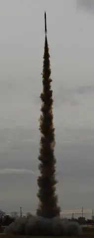
    </a>
    <figcaption>A rocket in flight.</figcaption>
  </figure>
  <figure>
    <a href="gallery/15.JPG" aria-label="Open original photograph: Launch-field shelter and equipment beneath a canopy">
      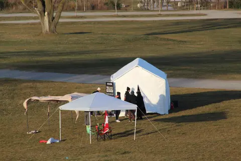
    </a>
    <figcaption>Launch-field setup.</figcaption>
  </figure>
  <figure>
    <a href="gallery/16.JPG" aria-label="Open original photograph: Students crouching beside a rocket on the launch field">
      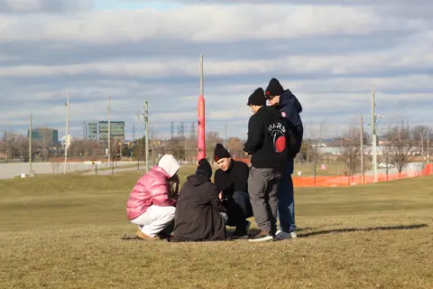
    </a>
    <figcaption>Preparing a rocket for launch.</figcaption>
  </figure>
  <figure>
    <a href="gallery/18.JPG" aria-label="Open original photograph: Students crossing the launch field">
      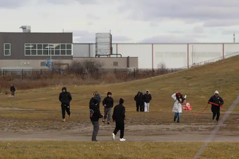
    </a>
    <figcaption>On the launch field.</figcaption>
  </figure>
  <figure>
    <a href="gallery/19.JPG" aria-label="Open original photograph: Students working on a rocket at a laboratory bench">
      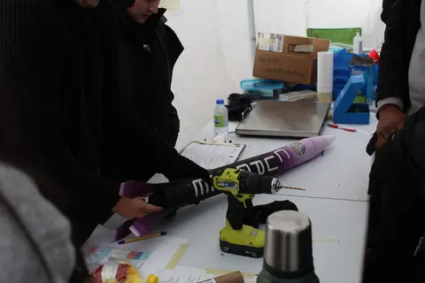
    </a>
    <figcaption>Workshop preparation.</figcaption>
  </figure>
  <figure>
    <a href="gallery/1.png" aria-label="Open original photograph: MARS members standing at a display of model rockets">
      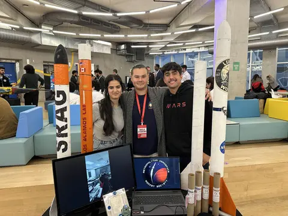
    </a>
    <figcaption>Sharing student rocketry.</figcaption>
  </figure>
  <figure>
    <a href="gallery/10.png" aria-label="Open original photograph: Rocket lifting off a grassy field in front of campus buildings">
      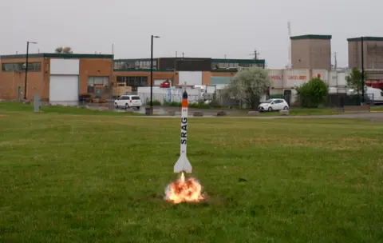
    </a>
    <figcaption>A model rocket lifts off.</figcaption>
  </figure>
  <figure>
    
    <figcaption>An outdoor rocket display.</figcaption>
  </figure>
  <figure>
    <a href="gallery/8.png" aria-label="Open original photograph: Student holding a tall rocket among trees">
      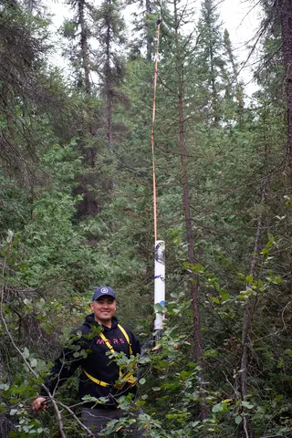
    </a>
    <figcaption>Rocket recovery in the trees.</figcaption>
  </figure>
  <figure>
    <a href="gallery/20.jpg" aria-label="Open original photograph: Students preparing equipment inside a field shelter">
      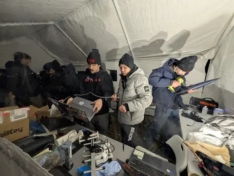
    </a>
    <figcaption>Working in the field shelter.</figcaption>
  </figure>
  <figure>
    <a href="gallery/17.JPG" aria-label="Open original photograph: Students standing together beside a launch-field rocket">
      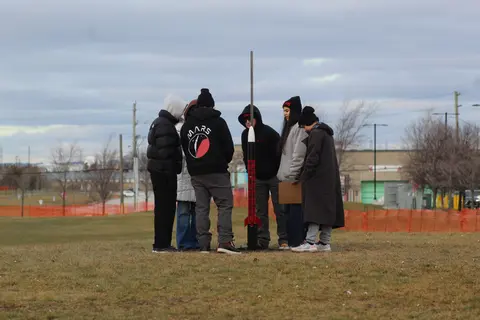
    </a>
    <figcaption>Teamwork on the launch field.</figcaption>
  </figure>
  <figure>
    <a href="gallery/21.jpg" aria-label="Open original photograph: Lit field shelter at dusk">
      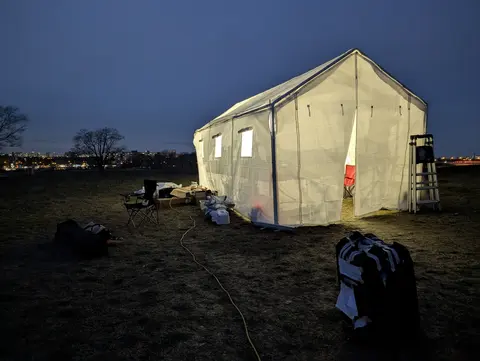
    </a>
    <figcaption>The field shelter at dusk.</figcaption>
  </figure>
  <figure>
    <a href="gallery/9.png" aria-label="Open original photograph: MARS members walking toward the launch-site building">
      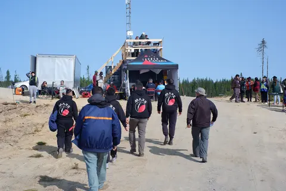
    </a>
    <figcaption>Walking through the launch site.</figcaption>
  </figure>
  <figure>
    <a href="gallery/14.png" aria-label="Open original photograph: Students carrying a rocket beside a building">
      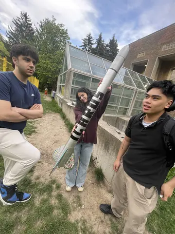
    </a>
    <figcaption>Carrying a completed rocket.</figcaption>
  </figure>
  <figure>
    <a href="gallery/13.png" aria-label="Open original photograph: Model rockets lined up on the grass behind safety tape">
      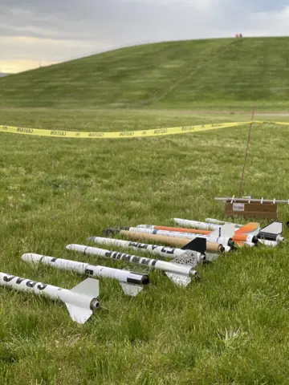
    </a>
    <figcaption>Rockets ready on the field.</figcaption>
  </figure>
  <figure>
    <a href="gallery/2.png" aria-label="Open original photograph: Presenter wearing a MARS hoodie addressing a classroom">
      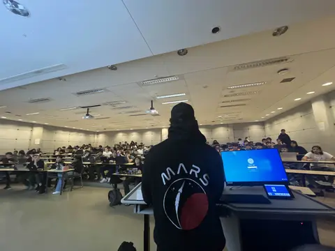
    </a>
    <figcaption>A student rocketry session.</figcaption>
  </figure>
  <figure>
    <a href="gallery/12.png" aria-label="Open original photograph: Students standing with their rocket beneath a tree">
      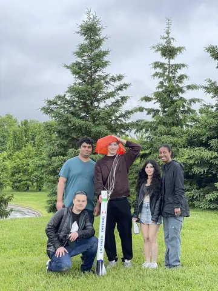
    </a>
    <figcaption>A team and its rocket.</figcaption>
  </figure>
  <figure>
    <a href="gallery/11.png" aria-label="Open original photograph: Two students posing beside a tall rocket">
      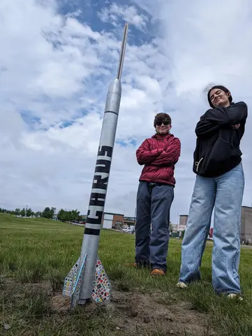
    </a>
    <figcaption>A completed student rocket.</figcaption>
  </figure>
  <figure>
    <a href="gallery/3.png" aria-label="Open original photograph: Students wearing gloves assembling a rocket in a workshop">
      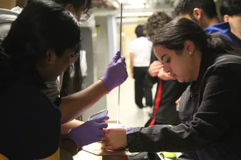
    </a>
    <figcaption>Building together in the workshop.</figcaption>
  </figure>
  <figure>
    <a href="gallery/4.png" aria-label="Open original photograph: Students working together at a rocket workshop table">
      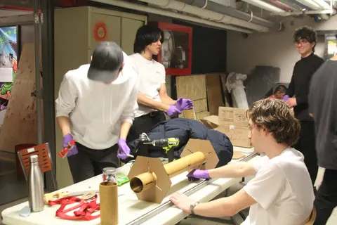
    </a>
    <figcaption>Hands-on rocket assembly.</figcaption>
  </figure>
  <figure>
    <a href="gallery/5.png" aria-label="Open original photograph: MARS members gathered around rockets at an outdoor display">
      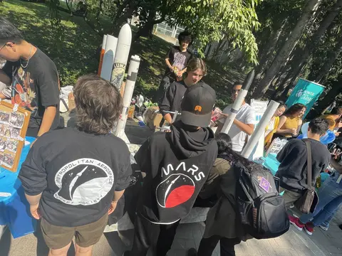
    </a>
    <figcaption>Showing rockets outdoors.</figcaption>
  </figure>
  <figure>
    <a href="gallery/6.png" aria-label="Open original photograph: Students preparing equipment at an outdoor canopy table">
      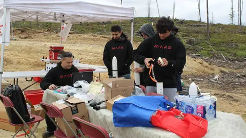
    </a>
    <figcaption>Preparing equipment at the field.</figcaption>
  </figure>
  <figure>
    <a href="assets/images/hero.jpg" aria-label="Open original photograph: Black rocket lifting off beside students on a grassy field">
      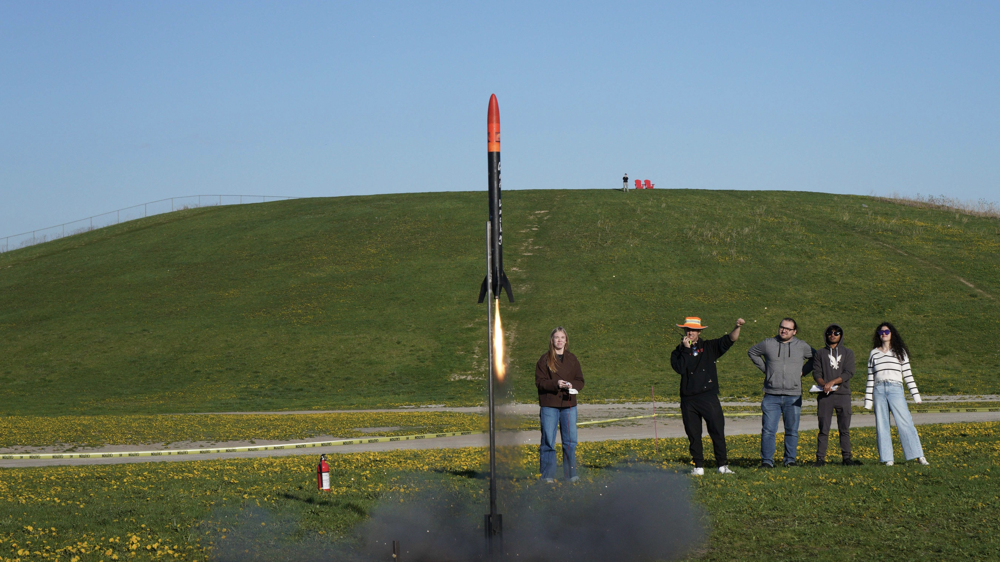
    </a>
    <figcaption>Liftoff on the launch field.</figcaption>
  </figure>
  <figure>
    <a href="assets/images/1.jpg" aria-label="Open original photograph: White-nosed rocket climbing on a smoke plume above a grassy hill">
      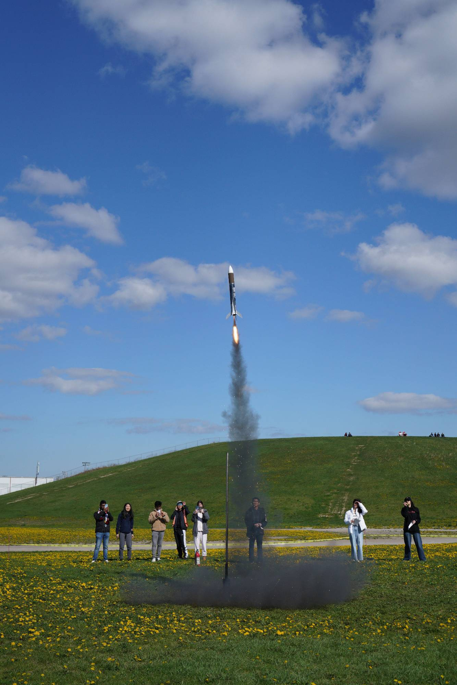
    </a>
    <figcaption>Climbing above the launch field.</figcaption>
  </figure>
  <figure>
    <a href="assets/images/3.jpg" aria-label="Open original photograph: Yellow rocket rising above students in banana costumes">
      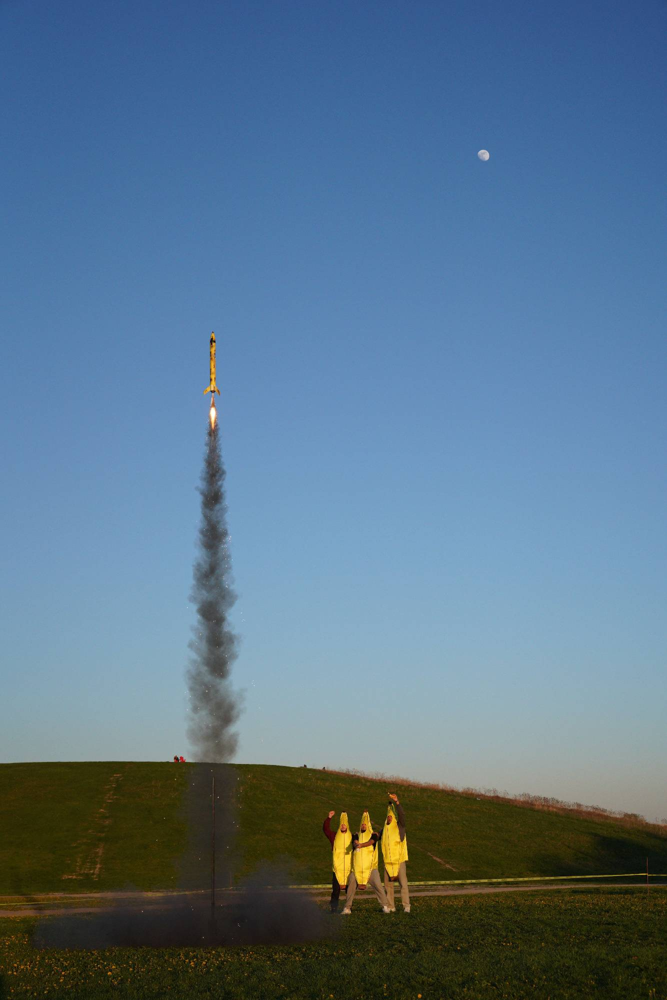
    </a>
    <figcaption>A yellow rocket takes flight.</figcaption>
  </figure>
  <figure>
    <a href="assets/images/pcb.jpg" aria-label="Open original photograph: Circuit board beneath a digital microscope on a workbench">
      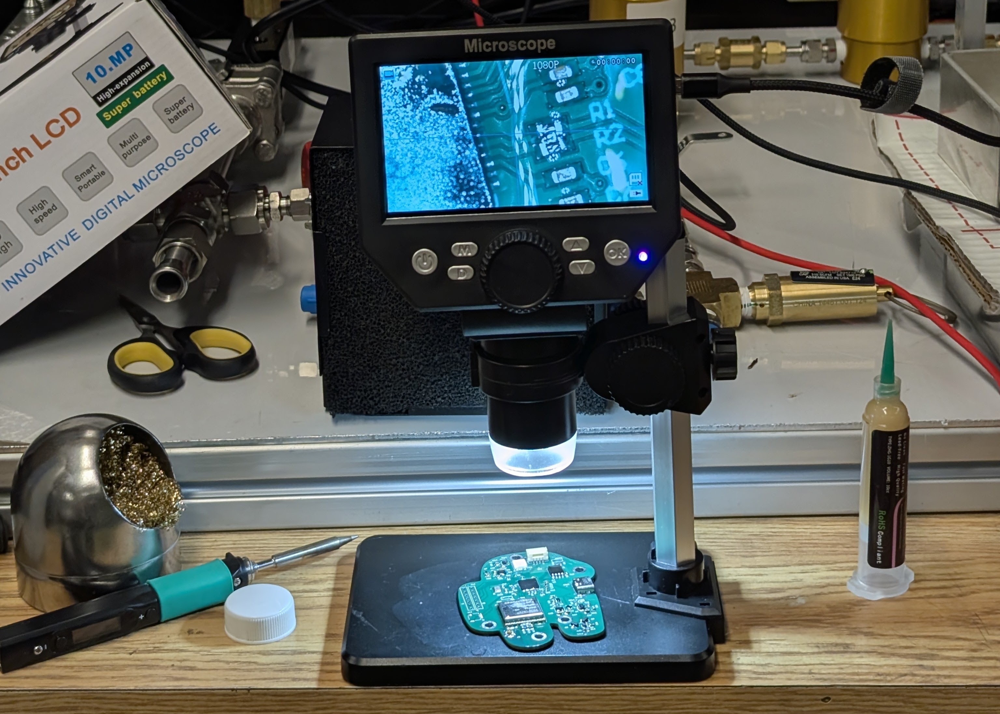
    </a>
    <figcaption>Inspecting rocket electronics.</figcaption>
  </figure>
  <figure>
    <a href="assets/images/2.jpg" aria-label="Open original photograph: Black rocket with a red nose cone climbing above a launch rod">
      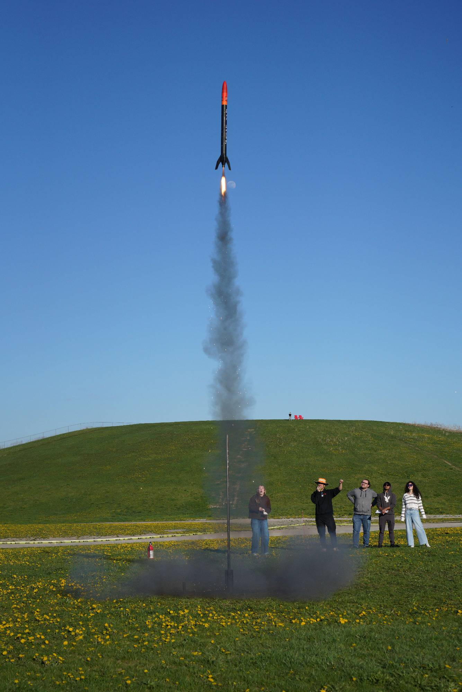
    </a>
    <figcaption>A rocket climbs into the sky.</figcaption>
  </figure>
  <figure>
    <a href="assets/images/zn.png" aria-label="Open original photograph: Two people silhouetted against the low sun">
      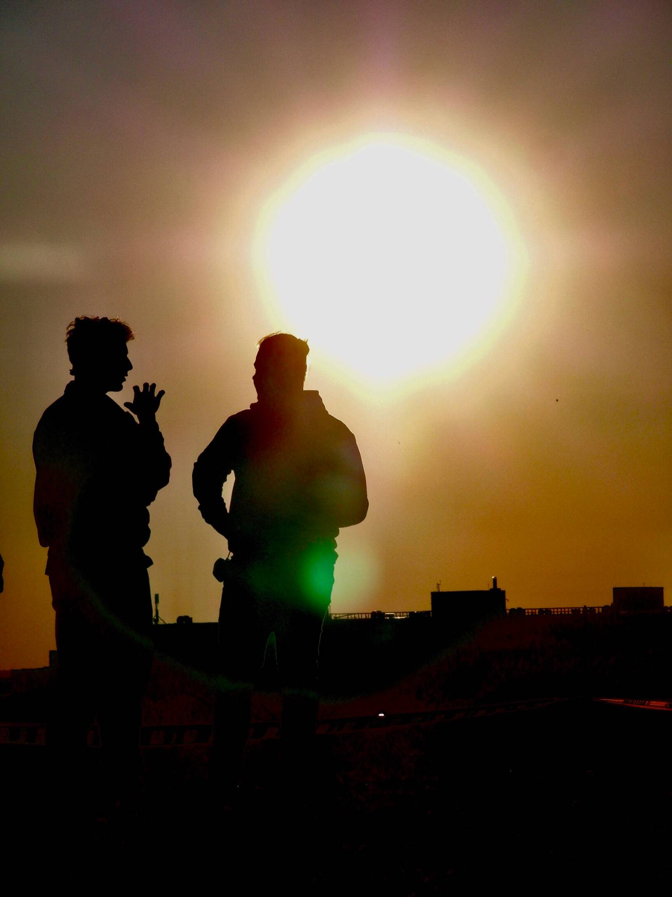
    </a>
    <figcaption>A moment at sunset.</figcaption>
  </figure>
  <figure>
    <a href="assets/images/15.png" aria-label="Open original photograph: Students standing on a grassy hill beneath a blue sky">
      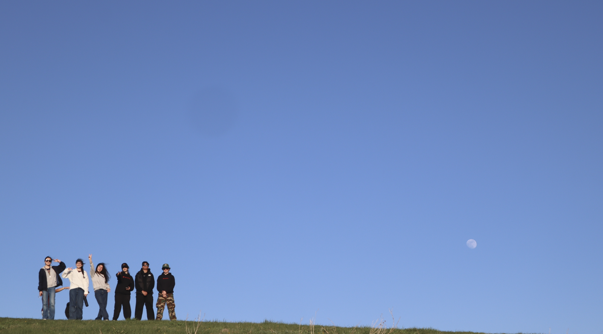
    </a>
    <figcaption>Together on the hill.</figcaption>
  </figure>
  <figure>
    
    <figcaption>The MARS community.</figcaption>
  </figure>

## Launch video

[Watch the archived launch video on YouTube](https://www.youtube.com/watch?v=jFPGU56kXCg).

  <button type="button" class="mars-video-facade__play" aria-label="Play archived MARS rocket launch video">
    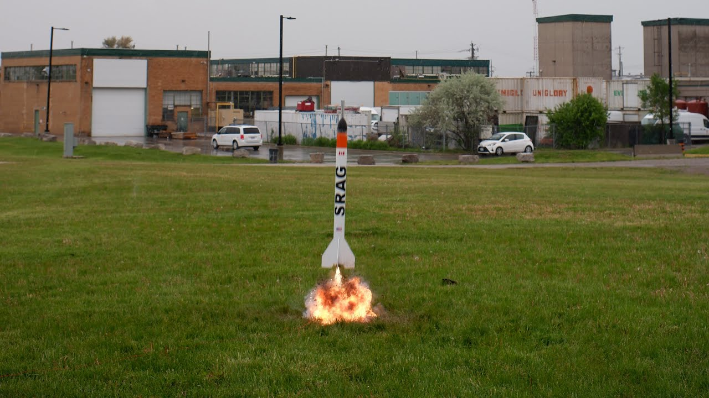
    <svg viewBox="0 0 24 24" focusable="false"><path d="M8 5v14l11-7z" fill="currentColor"/></svg>
  </button>

