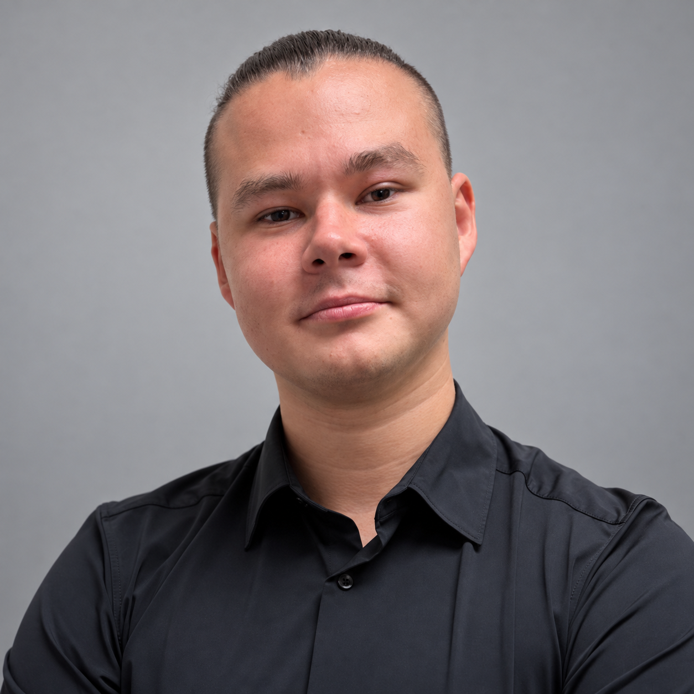
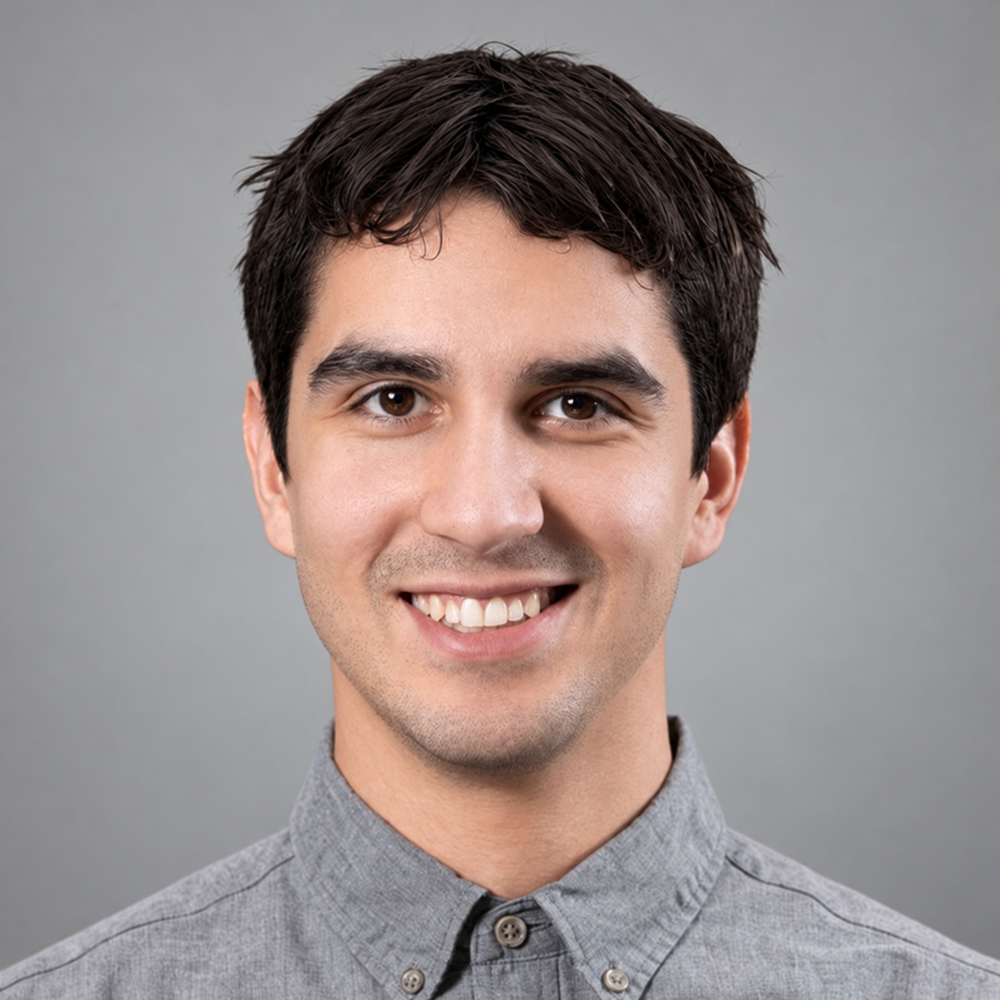

# Philosophy

The end goal of MARS is to make TMU have the best student rocketry in Canada.

## A letter from the founders

<blockquote class="mars-founders-letter" markdown="1">

*The Metropolitan Aerospace Rocket Society (MARS), founded by Nikolai Sydorenko and Zeulewan Mordasiewicz in 2023, is a student design team at Toronto Metropolitan University with the goal of educating students about model rocketry.*

*MARS opens the doors to designing, manufacturing, and launching rockets. We host tutorials to teach students all they need to know to create their own rockets!*

*During the summer months, MARS invites the top teams to attend Launch Canada, the country’s first and only annual rocket competition, to attain their Tripoli High Power Rocketry (HPR) certifications.*

</blockquote>

  <figure>
    

      
    

    <figcaption>
      
<strong>Nikolai</strong>Co-founder

      

        <a class="mars-founder__link" href="https://nikolaisydorenko.com/" target="_blank" rel="noopener noreferrer" aria-label="Nikolai's website" title="Nikolai's website"><svg aria-hidden="true" focusable="false" xmlns="http://www.w3.org/2000/svg" viewBox="0 0 512 512"><!--! Font Awesome Free 7.3.1 by @fontawesome - https://fontawesome.com License - https://fontawesome.com/license/free (Icons: CC BY 4.0, Fonts: SIL OFL 1.1, Code: MIT License) Copyright 2026 Fonticons, Inc.--><path fill="currentColor" d="M351.9 280H161c2.9 64.5 17.2 123.9 37.5 167.4 11.4 24.5 23.7 41.8 35.1 52.4 11.2 10.5 18.9 12.2 22.9 12.2s11.7-1.7 22.9-12.2c11.4-10.6 23.7-28 35.1-52.4 20.3-43.5 34.6-102.9 37.5-167.4zm-191-48h190.9c-2.8-64.5-17.1-123.9-37.4-167.4-11.4-24.4-23.7-41.8-35.1-52.4C268.1 1.7 260.4 0 256.4 0s-11.7 1.7-22.9 12.2c-11.4 10.6-23.7 28-35.1 52.4-20.3 43.5-34.6 102.9-37.5 167.4m-48 0c3.5-85.6 25.6-165.1 57.9-217.3C78.7 47.3 10.9 131.2 1.5 232zM1.5 280c9.4 100.8 77.2 184.7 169.3 217.3-32.3-52.2-54.4-131.7-57.9-217.3zm398.4 0c-3.5 85.6-25.6 165.1-57.9 217.3 92.1-32.7 159.9-116.5 169.3-217.3zm111.4-48C501.9 131.2 434.1 47.3 342 14.7c32.3 52.2 54.4 131.7 57.9 217.3z"/></svg></a>
        <a class="mars-founder__link" href="https://www.linkedin.com/in/nikolai-sydorenko" target="_blank" rel="noopener noreferrer" aria-label="Nikolai's LinkedIn" title="Nikolai's LinkedIn"><svg aria-hidden="true" focusable="false" xmlns="http://www.w3.org/2000/svg" viewBox="0 0 448 512"><!--! Font Awesome Free 7.3.1 by @fontawesome - https://fontawesome.com License - https://fontawesome.com/license/free (Icons: CC BY 4.0, Fonts: SIL OFL 1.1, Code: MIT License) Copyright 2026 Fonticons, Inc.--><path fill="currentColor" d="M416 32H31.9C14.3 32 0 46.5 0 64.3v383.4C0 465.5 14.3 480 31.9 480H416c17.6 0 32-14.5 32-32.3V64.3c0-17.8-14.4-32.3-32-32.3M135.4 416H69V202.2h66.5V416zM102.2 96a38.5 38.5 0 1 1 0 77 38.5 38.5 0 1 1 0-77m282.1 320h-66.4V312c0-24.8-.5-56.7-34.5-56.7-34.6 0-39.9 27-39.9 54.9V416h-66.4V202.2h63.7v29.2h.9c8.9-16.8 30.6-34.5 62.9-34.5 67.2 0 79.7 44.3 79.7 101.9z"/></svg></a>
      

    </figcaption>
  </figure>
  <figure>
    

      
    

    <figcaption>
      
<strong>Zeul</strong>Co-founder

      

        <a class="mars-founder__link" href="https://zeuldocs.com/" target="_blank" rel="noopener noreferrer" aria-label="Zeul's website" title="Zeul's website"><svg aria-hidden="true" focusable="false" xmlns="http://www.w3.org/2000/svg" viewBox="0 0 512 512"><!--! Font Awesome Free 7.3.1 by @fontawesome - https://fontawesome.com License - https://fontawesome.com/license/free (Icons: CC BY 4.0, Fonts: SIL OFL 1.1, Code: MIT License) Copyright 2026 Fonticons, Inc.--><path fill="currentColor" d="M351.9 280H161c2.9 64.5 17.2 123.9 37.5 167.4 11.4 24.5 23.7 41.8 35.1 52.4 11.2 10.5 18.9 12.2 22.9 12.2s11.7-1.7 22.9-12.2c11.4-10.6 23.7-28 35.1-52.4 20.3-43.5 34.6-102.9 37.5-167.4zm-191-48h190.9c-2.8-64.5-17.1-123.9-37.4-167.4-11.4-24.4-23.7-41.8-35.1-52.4C268.1 1.7 260.4 0 256.4 0s-11.7 1.7-22.9 12.2c-11.4 10.6-23.7 28-35.1 52.4-20.3 43.5-34.6 102.9-37.5 167.4m-48 0c3.5-85.6 25.6-165.1 57.9-217.3C78.7 47.3 10.9 131.2 1.5 232zM1.5 280c9.4 100.8 77.2 184.7 169.3 217.3-32.3-52.2-54.4-131.7-57.9-217.3zm398.4 0c-3.5 85.6-25.6 165.1-57.9 217.3 92.1-32.7 159.9-116.5 169.3-217.3zm111.4-48C501.9 131.2 434.1 47.3 342 14.7c32.3 52.2 54.4 131.7 57.9 217.3z"/></svg></a>
        <a class="mars-founder__link" href="https://www.linkedin.com/in/zeulewan/" target="_blank" rel="noopener noreferrer" aria-label="Zeul's LinkedIn" title="Zeul's LinkedIn"><svg aria-hidden="true" focusable="false" xmlns="http://www.w3.org/2000/svg" viewBox="0 0 448 512"><!--! Font Awesome Free 7.3.1 by @fontawesome - https://fontawesome.com License - https://fontawesome.com/license/free (Icons: CC BY 4.0, Fonts: SIL OFL 1.1, Code: MIT License) Copyright 2026 Fonticons, Inc.--><path fill="currentColor" d="M416 32H31.9C14.3 32 0 46.5 0 64.3v383.4C0 465.5 14.3 480 31.9 480H416c17.6 0 32-14.5 32-32.3V64.3c0-17.8-14.4-32.3-32-32.3M135.4 416H69V202.2h66.5V416zM102.2 96a38.5 38.5 0 1 1 0 77 38.5 38.5 0 1 1 0-77m282.1 320h-66.4V312c0-24.8-.5-56.7-34.5-56.7-34.6 0-39.9 27-39.9 54.9V416h-66.4V202.2h63.7v29.2h.9c8.9-16.8 30.6-34.5 62.9-34.5 67.2 0 79.7 44.3 79.7 101.9z"/></svg></a>
      

    </figcaption>
  </figure>

## Community first, technology second

MARS, which aims to push the boundaries of student rocketry, will only thrive with a strong community that is constantly teaching and recruiting new members. This is why we make model rocketry our priority.

We will not develop any technology without a strong community of friends.

## Open source

We have everything to gain from the success of others. We strive to learn from and contribute to each step of the process.

All code, PCB schematics, and CAD files should be made open source on GitHub.

## Documentation

- It makes the team easier to join if you know what is going on.
- The website is the way we build our reputation, and compete with other schools.
- The website is the first thing sponsors look at when checking out whether or not to sponsor us.

## Technical work

CAD, 3D printing, altitude calculations, composite layup, and avionics.

## Keep the team alive, and growing

The most important thing is keeping the team alive, not getting stressed, and keeping an open as well as open source community. MARS should also foster a bond between leads.

One of the primary goals of leads on the team is to find younger years to replace themselves.
